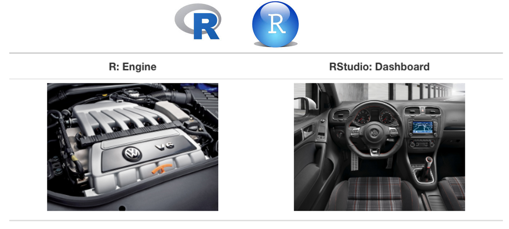
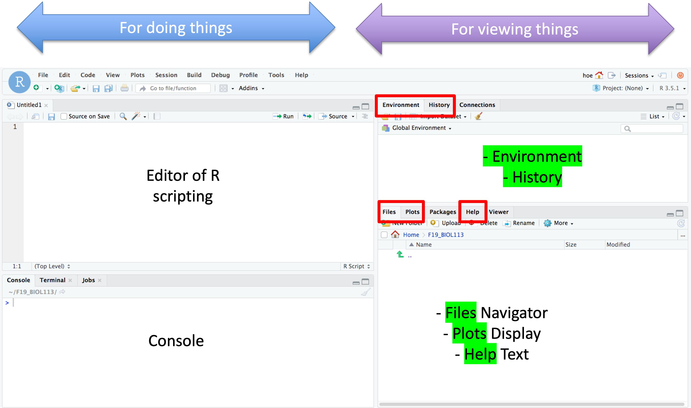
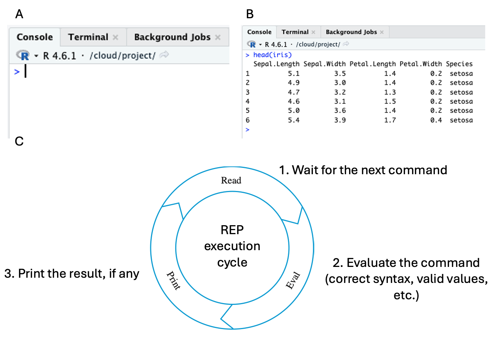
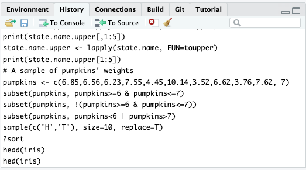

# R and RStudio

This chapter primarily focuses on using RStudio for data and statistical analysis. If you are new to RStudio, this chapter provides a quick overview of this indispensable interactive development environment (IDE). A note about names. You will come across the name Posit here. In 2022, the management team of RStudio wanted to expand the tool to support other programming languages, including Python and Julia. Therefore, they renamed it **Posit**. Since our focus is on R scripting, we will continue to refer to the IDE as RStudio. And RStudio is still a popular name in the R community. Without further delay, let's get started.

## Learning Objectives: {.unnumbered}

- Understand the differences between R and RStudio.

- Understand different options for accessing RStudio.

- Understand the basic components of the RStudio user interface.

## R vs. RStudio

RStudio depends on R. Using a car analogy, nobody drives a car by pulling the engine's throttle directly. R is like the engine, and RStudio is like the dashboard. RStudio provides a user-friendly Interactive Development Environment (IDE) that lets users instruct R to perform the actual work.

{fig-alt="R vs. RStudio"}

## Accessing RStudio

There are two options for accessing RStudio: using a cloud service (Posit Cloud) or installing RStudio on your own computer. For the first option, no software installation is required. All you need is a web browser and an internet connection. For the first time, sign up for a Posit account from here: [Posit Cloud](https://posit.cloud/plans?utm_source=Website&utm_medium=IDE_Download) and choose a plan. A basic free plan is sufficient for everything discussed in this book. Your work will be saved in the cloud under your account. Regardless of what computer you use and where you work, everything you have saved will be available in your account.

Alternatively, if you prefer better control of RStudio, you can install two software packages, R and RStudio, in that sequence, on your own computers. Then it becomes your responsibility to maintain and update them. A favorable feature of R is that it can be installed on a Windows or a Mac computer. If your computer is a Chromebook, Posit Cloud is preferred, as installing R and RStudio on a Chromebook is less straightforward. For Windows and Mac, the installation is simple; it only takes a few double-clicks. Note that you must install R before RStudio. Here are the links to download [R](https://cran.r-project.org/) and [RStudio](https://posit.co/download/rstudio-desktop/).

## Basic Components of RStudio

Below is a typical, default appearance of the RStudio interface.

{#fig-6-2}

The interface is divided into **four panes**, each with a different function. The two panes on the left are designated for doing things. The two right panes are for viewing.

### Files/Plots/Help

Let's begin with the lower right pane. Treat it like Finder on Mac or Explorer on Windows. The **Files** tab helps you navigate the cloud storage or local drive. The **Plots** tab stores the graphs created in the current session. They will be removed once you sign off from the cloud or quit RStudio. The **Help** tab shows the help documentation.

### Console

The lower left pane is called the **console**. When you move the mouse anywhere within the console and click it, attention is on the console as shown below:

The `>` symbol in Figure 6-3A is the prompt. Next to it is a blinking cursor, usually a vertical bar `|`. At this stage, the R engine is waiting for an instruction. For example, you enter `head(iris)` and hit the `return` button (Figure 6-3B), the R engine will go through the REP (**R**ead-**E**val-**P**rint) execution cycle (Figure 6-3C). At the Read stage, the R engine listens to incoming commands, e.g., `head(iris)`. It will then evaluate whether the command(s) are valid (in terms of syntax and required input values). If the command is correct, the R engine will execute it and print the results, if any, at the console. If the command is invalid, an error message will be printed at the console, usually in red.

The console is usually the place for rapid try-and-error, or **prototyping**. Additionally, all commands entered at the console are saved to a history log (discussed below).

### Environment/History

The **Environment** tab in the top right pane is like a CT scan of one's memory. It shows all the variables created in the current session. This feature is extremely useful for troubleshooting scripting problems.

RStudio splits the variables into three categories: **Data,** **Values,** and **Functions**. The Data subsection keeps data frames @sec-01-data-frames. There is a little play button next to each data frame. Clicking it will expand to a list of variables belonging to the data frame. The Values subsection lists other types of variables and a glimpse of their values, such as atomic variables @sec-01-atomic-and-composite-variables, vectors @sec-01-vectors, and list objects @sec-05-list-objects. Lastly, the Functions subsection shows the user-defined functions and the arguments @sec-05-define-functions.

The Environment tab also provides a function to import data into RStudio. See @sec-05-3-2-Import-Data-RStudio.

Another useful feature is the **History** tab. All commands executed, correct or incorrect, in the current session will be recorded in the History tab.

One way to make script development more convenient is to copy previously executed, tested commands from the History log to the console or a file without retyping them. Let's say you want to re-execute `head(iris)` again. You can highlight that command in the History tab and click the **"To Console"** button. The command will be copied to the console. Likewise, you can direct the copying to a script file opened by the editor (top left pane in @fig-6-2) by clicking the **"To Source"** button.

### Editor

The last pane is the editor function on the top left. It is the place to write the R script that contains several R commands. To create a new R script file, click the menu option (top left) **File -\> New File -\> R Script**. A blank file is shown, and you can start writing R commands in it. Once you are done, you can save it by clicking the floppy disk icon near the top left or by selecting the File menu option **Save**. You can also use the File menu option to open an existing R script file.

There are two ways to execute the command(s) in the current script. To run the entire script file from the first line to the last line, click the **"Source"** button near the top left of the editor window. To run specific command(s), use the mouse to select the line(s) of interest and click the **"Run"** button, which is located next to the **"Source"** button.

## Summary

Here is a short overview of essential RStudio features. They should be adequate for 80% of the task. Scripting is a practical skill. It is best learned through hands-on practice; it is like learning to swim. You don't just listen to instructions. You've got to jump into the water and get wet! Therefore, I highly encourage you to try out the examples and exercises in the RStudio environment.
